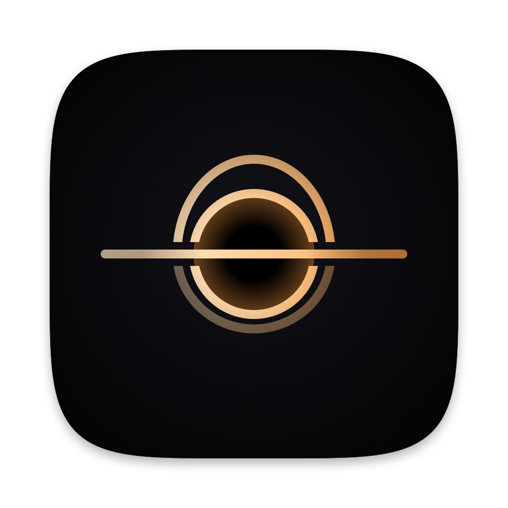

<p align="center"></p>

<h1 align="center">LlMBO</h1>

<p align="center"><b>English</b> · <a href="README.pt-BR.md">Português (Brasil)</a></p>

<p align="center"><b>Close the lid. Not your work.</b><br>
Lets your MacBook keep working with the lid closed while your AI agents run, and puts the Mac to sleep as soon as they all finish.</p>

<p align="center">
<a href="https://github.com/fcknferreira/LlMBO/releases/latest/download/LlMBO.dmg"><b>Download for macOS</b></a> ·
free · open source (MIT) · macOS 13 or later · Apple Silicon and Intel
</p>

---

## What it does

You give Claude Code, Codex, Antigravity, Cursor… a long task and want to close the lid and walk away. macOS puts the Mac to sleep right away and the agent stops halfway. LlMBO fixes that:

- **Keeps the Mac awake only while an agent is working** — lid closed on a desk, not in a backpack (see the safety locks).
- **Knows when each agent is done** through the agents' official hooks (they report instantly), their session files and, as a last resort, CPU/GPU use.
- **Brings normal sleep back** once everything is quiet, and tells you: "Agents finished at 03:12".
- **Waits for approvals** the agent asks for, for a configurable time, so you can approve from elsewhere.
- **Usage limits:** shows tokens and limits; can wake the Mac when Claude Code's limit resets.
- **Long tasks:** builds, tests and downloads can hold the Mac from the terminal (`llmbo-signal hold -- npm run build`) or through LlMBO's MCP server, which agents use on their own.
- **Background commands:** when Claude Code finishes its reply but leaves a command running in the background (a build, a test, a wait), the Mac stays awake until it ends, up to a limit you choose.
- **Widgets:** "LlMBO" shows whether the Mac is being kept awake and why, or when the agents finished; "Usage limits" shows how much of the Claude Code, Codex and Antigravity limits is used and when they come back.

Works with Claude Code, Codex, Antigravity (app, IDE and CLI), Gemini CLI, Qwen Code, GitHub Copilot (CLI and VS Code), Cursor, OpenCode, Crush, Aider, Cline, Roo Code, Kilo Code, Continue, Kiro, Windsurf, Amp, Goose, DeepSeek Harness and local AI (Ollama, LM Studio, llama.cpp, MLX, Jan). You can also add your own.

The app is available in 23 languages.

## Install

**From Terminal (easiest, recommended)** — no warning at all, because files downloaded with `curl` don't get the quarantine flag:

```bash
curl -fsSL https://raw.githubusercontent.com/fcknferreira/LlMBO/main/install.sh | bash
```

**From the DMG:** download [LlMBO.dmg](https://github.com/fcknferreira/LlMBO/releases/latest/download/LlMBO.dmg), drag it to Applications and open it.

> [!CAUTION]
> **The first time, macOS will suggest "Move to Trash". DO NOT click it.** Click **Done**. The warning only appears because LlMBO is free and doesn't pay Apple's $99/year Developer Program — not because anything is wrong with it (all the code is here). Recent macOS versions no longer offer an "Open" button in that warning; this is the way:
>
> 1. Open **System Settings › Privacy & Security** and scroll to the bottom.
> 2. Click **Open Anyway** next to LlMBO, confirm **Open Anyway** again and enter your password.
> 3. That button only shows for about an hour after you try to open the app. If it's gone, try opening LlMBO again.
>
> Only once — later updates come through the app itself.

The script downloads the latest version, checks that it carries the signature of LlMBO's Releases and installs it in `/Applications`.

On first launch, a setup assistant asks for your administrator password once. It installs `/etc/sudoers.d/llmbo`, which allows **only** these commands without a password: `pmset -a disablesleep 0/1`, `pmset schedule wake …` and `pmset schedule cancel wake …`. Nothing else.

## Privacy

Everything runs on your Mac. LlMBO has no server, collects no data and sends nothing about you anywhere. The only network request is a check on GitHub for new versions, once a day (you can turn it off in the About tab). The **Report a Problem…** button only opens a pre-filled issue in your browser, for you to review before sending.

## Updating

The app looks for new versions once a day and when you click **Check for Updates…** (About tab). **Update** downloads, checks the signature, swaps the app and reopens it — without letting the Mac sleep if agents are working.

## Safety

- Minimum battery, maximum time awake (separate for battery and power adapter) and temperature protection bring sleep back.
- With the lid closed, the internal screen is turned off while agents work.
- A watchdog (a process of LlMBO itself) restores sleep within ~1 min if the app hangs or is force-quit.
- When you quit, sleep goes back to normal.

> A closed Mac kept awake inside a backpack gets hot. Use it on a desk.

## Uninstall

Use **Uninstall…** in the About tab: it removes the `sudo` rule, the hooks, the MCP server and the app itself. Dragging the app to the Trash leaves the rule behind. If something goes wrong and the Mac no longer sleeps when you close the lid:

```bash
sudo pmset -a disablesleep 0
```

## Building

Only needs the Command Line Tools (`xcode-select --install`).

```bash
./build.sh          # builds build/LlMBO.app
./build.command     # builds, installs to /Applications and opens it
./release.sh 0.2    # public version: zip + DMG in dist/ (--publish creates the Release)
```

## Issues and suggestions

[Open an issue](https://github.com/fcknferreira/LlMBO/issues) or use **Report a Problem…** in the About tab.

Website: [llmbo.app](https://llmbo.app) · Instagram and Threads: [@llmbo.app](https://www.instagram.com/llmbo.app/) · License: [MIT](LICENSE)

## Reporting a security issue

LlMBO uses a `sudo` rule to turn sleep on and off. If you find a security issue, **please don't open a public issue**: write through the [contact form](https://llmbo.app/contact.html), which only reaches the author. Once there's a fix, it ships in a new version and the public notice comes after.
