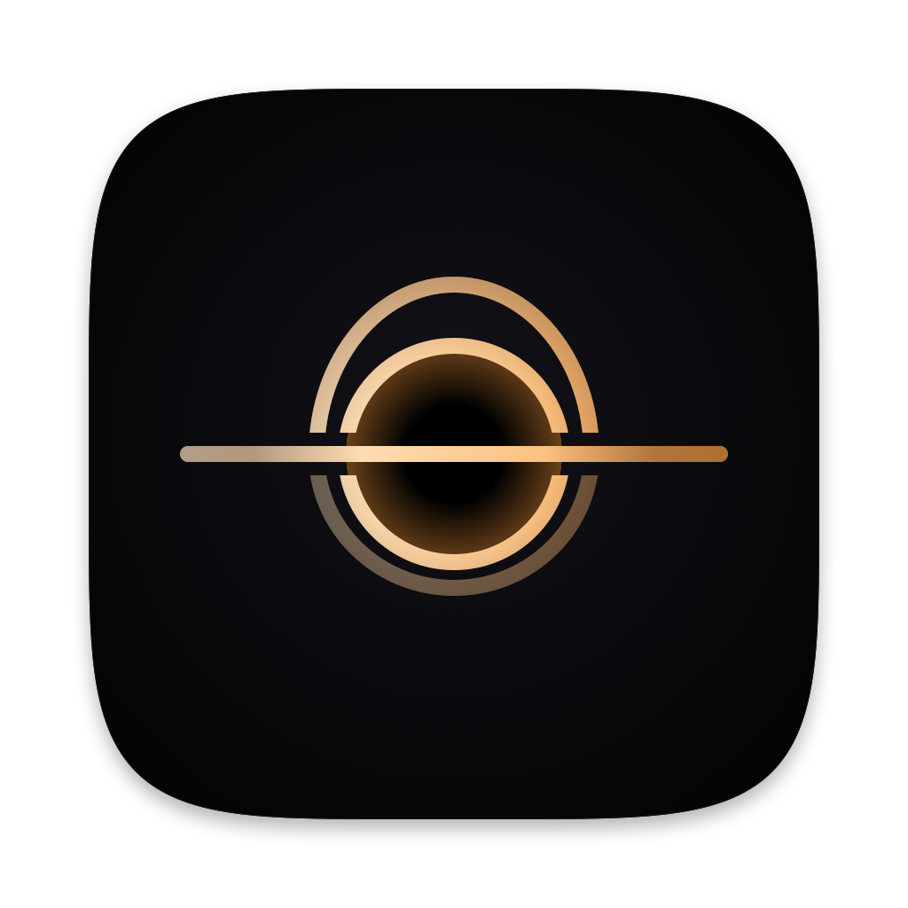

<p align="center"></p>

<h1 align="center">LlMBO</h1>

<p align="center"><a href="README.md">English</a> · <b>Português (Brasil)</b></p>

<p align="center"><b>Feche a tampa. Não o seu trabalho.</b><br>
Deixa o MacBook trabalhar de tampa fechada enquanto seus agentes de IA rodam, e põe o Mac para dormir assim que todos terminam.</p>

<p align="center">
<a href="https://github.com/fcknferreira/LlMBO/releases/latest/download/LlMBO.dmg"><b>Baixar para macOS</b></a> ·
grátis · código aberto (MIT) · macOS 13 ou mais novo · Apple Silicon e Intel
</p>

---

## O que ele faz

Você pede uma tarefa longa ao Claude Code, Codex, Antigravity, Cursor… e quer fechar a tampa e ir embora. O macOS põe o Mac para dormir na hora e o agente para no meio. O LlMBO resolve isso:

- **Segura o Mac acordado só enquanto algum agente trabalha** — de tampa fechada, na mochila não (veja as travas).
- **Sabe quando cada agente terminou** pelos hooks oficiais dos agentes (avisam na hora), pelos arquivos de sessão e, como último recurso, pela CPU/GPU.
- **Devolve o repouso normal** quando tudo fica quieto e avisa: "Agentes terminaram às 03:12".
- **Espera aprovações** pedidas pelo agente por um tempo configurável, para você aprovar de longe.
- **Limites de uso:** mostra tokens e limites; pode acordar o Mac quando o limite do Claude Code volta.
- **Tarefas longas:** builds, testes e downloads seguram o Mac pelo terminal (`llmbo-signal hold -- npm run build`) ou pelo servidor MCP do LlMBO, que os agentes usam sozinhos.
- **Comandos em segundo plano:** quando o Claude Code termina a resposta mas deixa um comando rodando em segundo plano (um build, um teste, uma espera), o Mac fica acordado até ele acabar, com um limite que você escolhe.
- **Widgets:** "LlMBO" mostra se o Mac está sendo segurado e por quê, ou quando os agentes terminaram; "Limites de uso" mostra quanto dos limites do Claude Code, do Codex e do Antigravity já foi usado e quando voltam.

Funciona com Claude Code, Codex, Antigravity (app, IDE e CLI), Gemini CLI, Qwen Code, GitHub Copilot (CLI e VS Code), Cursor, OpenCode, Crush, Aider, Cline, Roo Code, Kilo Code, Continue, Kiro, Windsurf, Amp, Goose, DeepSeek Harness e IA local (Ollama, LM Studio, llama.cpp, MLX, Jan). Você também pode cadastrar o seu.

## Instalar

**Pelo Terminal (mais fácil, recomendado)** — sem aviso nenhum, porque arquivos baixados pelo `curl` não ganham a marca de quarentena:

```bash
curl -fsSL https://raw.githubusercontent.com/fcknferreira/LlMBO/main/install.sh | bash
```

**Pelo DMG:** baixe o [LlMBO.dmg](https://github.com/fcknferreira/LlMBO/releases/latest/download/LlMBO.dmg), arraste para Aplicativos e abra.

> [!CAUTION]
> **Na primeira vez o macOS vai sugerir "Mover para o Lixo". NÃO clique nesse botão.** Clique em **Concluído**. O aviso aparece só porque o LlMBO é grátis e não paga os US$ 99 por ano do Apple Developer Program — não porque haja algo de errado com ele (o código está todo aqui). Nas versões recentes do macOS o aviso nem oferece mais o botão "Abrir"; o caminho é este:
>
> 1. Abra **Ajustes do Sistema › Privacidade e Segurança** e role até o fim.
> 2. Clique em **Abrir Mesmo Assim** ao lado do LlMBO, confirme **Abrir Mesmo Assim** de novo e digite a sua senha.
> 3. Esse botão só aparece por cerca de uma hora depois da tentativa de abrir. Se sumiu, tente abrir o LlMBO de novo.
>
> Só uma vez — as atualizações seguintes chegam pelo próprio app.

O script baixa a última versão, confere se ela tem a assinatura das Releases do LlMBO e instala em `/Applications`.

Na primeira abertura, um assistente pede a senha de administrador uma vez. Ela instala `/etc/sudoers.d/llmbo`, que libera **só** estes comandos sem senha: `pmset -a disablesleep 0/1`, `pmset schedule wake …` e `pmset schedule cancel wake …`. Nada mais.

## Privacidade

Tudo roda no seu Mac. O LlMBO não tem servidor, não coleta dados e não manda nada sobre você para lugar nenhum. A única conexão é a consulta ao GitHub por versões novas, uma vez por dia (dá para desligar na aba Sobre). O botão **Relatar problema…** só abre uma issue no navegador, já preenchida, para você revisar antes de enviar.

## Atualizar

O app procura versões novas uma vez por dia e no botão **Procurar atualizações…** (aba Sobre). **Atualizar** baixa, confere a assinatura, troca o app e reabre — sem soltar o Mac se houver agentes trabalhando.

## Segurança

- Bateria mínima, tempo máximo acordado (separado para bateria e tomada) e proteção de temperatura religam o repouso.
- Com a tampa fechada, a tela interna é apagada enquanto os agentes trabalham.
- Um vigia (processo do próprio LlMBO) devolve o repouso em ~1 min se o app travar ou for encerrado à força.
- Ao sair, o repouso volta ao normal.

> Mac fechado e acordado dentro da mochila esquenta. Use em cima da mesa.

## Desinstalar

Use **Desinstalar…** na aba Sobre: ele tira a regra do `sudo`, os hooks, o servidor MCP e o próprio app. Arrastar o app para o Lixo deixa a regra para trás. Se algo der errado e o Mac não dormir mais ao fechar a tampa:

```bash
sudo pmset -a disablesleep 0
```

## Compilar

Precisa só das Command Line Tools (`xcode-select --install`).

```bash
./build.sh          # gera build/LlMBO.app
./build.command     # compila, instala em /Applications e abre
./release.sh 0.2    # versão pública: zip + DMG em dist/ (--publish cria a Release)
```

## Problemas e sugestões

[Abra uma issue](https://github.com/fcknferreira/LlMBO/issues) ou use **Relatar problema…** na aba Sobre.

Site: [llmbo.app](https://llmbo.app) · Instagram e Threads: [@llmbo.app](https://www.instagram.com/llmbo.app/)

## Relatar uma falha de segurança

O LlMBO usa uma regra do `sudo` para ligar e desligar o repouso. Se você achar uma falha de segurança, **não abra uma issue pública**: escreva pelo [formulário de contato](https://llmbo.app/contact.html), que chega só para o autor. Quando houver correção, ela sai numa versão nova e o aviso público vem depois.
